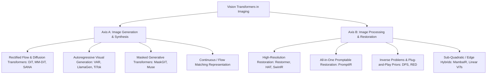

# Research Topics in Vision Transformers: Image Synthesis, Generation, and Classical-to-Modern Image Processing

**Author:** Feynman Research System  
**Date:** October 2026  
**Artifact Path:** `outputs/transformer_image_synthesis_processing_research_topics.md`

---

## Executive Summary

The transition from convolutional neural networks (CNNs) to Vision Transformers (ViTs) has reshaped both generative image synthesis and low-level image processing. However, unlike natural language processing where token sequences have unambiguous discrete and causal orderings, visual data poses fundamental challenges: spatial bi-directionality, high dimensionality ($H \times W \times C$), continuous intensity variations, and distinct spectral characteristics across spatial frequencies.

This document defines **8 research topics** structured into two main axes:
1. **Axis A: Generative Image Synthesis via Transformers** (Flow matching, visual autoregression, 1D/continuous visual tokenizers, and multimodal generative transformers).
2. **Axis B: Image Processing Algorithms and Inverse Problems via Transformers** (Frequency-aware self-attention, all-in-one restoration, plug-and-play diffusion priors for inverse problems, and linear-time/State-Space hybrid transformers for edge ISPs).

Each topic provides the formal mathematical problem formulation, existing limitations, concrete experimental protocols, measurable evaluation metrics, and primary references.

---

## Taxonomy of Paradigms



---

## Axis A: Image Synthesis and Generative Modeling

### Topic 1: Rectified Flow Transformers with Dynamic Token Sparsity and Multi-Modal Stream Coupling

#### 1. Problem Formulation & Theoretical Motivation
Current state-of-the-art text-to-image foundation models (e.g., Stable Diffusion 3, FLUX.1) deploy Multimodal Diffusion Transformers (MM-DiT) parameterized by Rectified Flow (RF). Given clean image latents $x_1 \sim p_1(x)$ and standard Gaussian noise $x_0 \sim \mathcal{N}(0, \mathbf{I})$, RF establishes an ordinary differential equation (ODE) along the straight probability path:
$$x_t = (1 - t)x_0 + t x_1, \quad t \in [0, 1]$$
The transformer predicts the constant-velocity vector field $v_\theta(x_t, t, c) \approx \frac{d x_t}{dt} = x_1 - x_0$, minimizing:
$$\mathcal{L}_{\mathrm{RF}}(\theta) = \mathbb{E}_{t, x_0, x_1} \left[ \| v_\theta(x_t, t, c) - (x_1 - x_0) \|_2^2 \right]$$

**Core Bottleneck:** In high-resolution synthesis (e.g., $1024 \times 1024$ or $2048 \times 2048$), the sequence length of image patch tokens $N = (H/p) \times (W/p)$ grows quadratically in full self-attention $\mathcal{O}(N^2)$. While early trajectory steps ($t \approx 0$) establish global layout and composition, late trajectory steps ($t \approx 1$) primarily denoise local high-frequency textures. Evaluating full self-attention across all tokens at every ODE sampling step is computationally redundant.

#### 2. Specific Research Questions
1. Can time-dependent dynamic token pruning or spatial clustering be integrated into the transformer blocks without breaking the numerical stability of the ODE solver?
2. How should cross-attention and self-attention pathways between text tokens $c$ and image tokens $x_t$ be dynamically uncoupled across ODE timesteps $t \in [0, 1]$ as text conditioning guidance fades in late sampling stages?
3. How does classifier-free guidance (CFG) distillation interact with token sparsity schemes during few-step (1-4 step) inference?

#### 3. Proposed Experimental Methodology & Protocol
- **Architecture:** 1B to 3B parameter MM-DiT baseline (dual-stream text/image attention transitioning to single-stream).
- **Intervention:** 
  - Introduce an adaptive token router $\pi_\phi(z_t, t)$ that computes token saliency and drops or merges low-gradient spatial tokens at $t > 0.6$.
  - Implement caching of Keys and Values ($K, V$) for low-frequency tokens across successive Euler/Heun ODE steps.
- **Datasets:** ImageNet-256/512 (conditional), MS-COCO 2017, and JourneyDB / CC12M (text-to-image).
- **Baselines:** DiT-XL/2 (Peebles & Xie, 2023), SD3/MM-DiT (Esser et al., 2024), SANA (Xie et al., 2024).
- **Metrics:** Fréchet Inception Distance (FID-50K), Inception Score (IS), CLIP Score, GenEval benchmark, and Inference TFLOPs / Wall-clock Latency (ms).

---

### Topic 2: Visual Autoregressive (VAR) Modeling vs. Discrete Diffusion: Scale-Wise Tokenization and Error Accumulation

#### 1. Problem Formulation & Theoretical Motivation
Conventional Autoregressive (AR) models for images (e.g., ImageGPT, LlamaGen) serialize 2D token grids into 1D sequences via raster-scan order, violating spatial locality and accumulating prediction error along long sequences. Visual Autoregressive (VAR) models reframe image generation from "next-token prediction" to **"next-scale prediction"**:
$$p(r_1, r_2, \dots, r_K) = \prod_{k=1}^K p(r_k \mid r_1, r_2, \dots, r_{k-1})$$
where $r_k \in \mathbb{R}^{h_k \times w_k}$ represents visual latent codes at scale $k$, progressing from low resolution ($1 \times 1$) to high resolution ($32 \times 32$ or $64 \times 64$).

**Core Bottleneck:** Scale-wise generation introduces compound error accumulation: artifacts or semantic misalignments created at coarse scales ($r_1, r_2$) propagate irreversibly to fine scales ($r_K$). Furthermore, vector-quantized codebooks suffer from codebook underutilization and reconstruction distortion compared to continuous diffusion representations.

#### 2. Specific Research Questions
1. Can bidirectional self-refinement or scale-wise gradient feedback loops prevent irreversible coarse-scale semantic hallucinations in next-scale transformers?
2. How does continuous multi-scale autoregressive modeling (predicting continuous latent Gaussian distributions via Gaussian Mixture Models or continuous diffusion heads) compare against vector-quantized (VQ-VAE / VQ-GAN) codebooks in visual fidelity?
3. Can 1D compact tokenizers (e.g., 1D TiTok with 32-64 tokens) maintain competitive generation diversity against 2D multi-scale representations?

#### 3. Proposed Experimental Methodology & Protocol
- **Architecture:** Decoder-only transformer with causal scale-masking (all tokens within scale $r_k$ attend bidirectionally to each other, but only causally to scales $< k$).
- **Intervention:** 
  - Design a dual-pass Scale-Correction Transformer that dynamically re-samples coarse-scale tokens conditioned on intermediate fine-scale candidate states.
  - Formulate an entropy-regularized continuous diffusion head at the output of the scale-wise transformer blocks instead of cross-entropy classification over a fixed codebook.
- **Datasets:** ImageNet-1k (256x256, 512x512).
- **Baselines:** VAR-d16/d30 (Tian et al., 2024), LlamaGen (Sun et al., 2024), MaskGIT (Chang et al., 2022), DiT-XL/2.
- **Metrics:** rFID (reconstruction FID), gFID (generation FID), precision/recall, training throughput (images/sec), and sampling steps required for convergence.

---

### Topic 3: Unified Multimodal Foundation Transformers: Co-Training Visual Understanding and High-Fidelity Synthesis

#### 1. Problem Formulation & Theoretical Motivation
Modern AI architectures are largely bifurcated: Vision-Language Models (VLMs like LLaVA, Flamingo) use causal autoregression over discrete text tokens conditioned on frozen ViT encoders (CLIP/SigLIP), whereas generative image models (FLUX, SD3, Midjourney) rely on separate diffusion/flow UNets or DiTs. A holy grail in computer vision is **Unified Omnimodal Transformers** that process interleaved text, audio, and visual tokens within a single set of transformer weights.

**Core Bottleneck:** The "Representation Conflict":
- Semantic understanding benefits from high-level, invariant, invariant-to-texture representations (e.g., contrastive loss / CLIP embeddings).
- High-fidelity synthesis requires low-level, high-frequency spatial reconstruction latents (e.g., VAE or continuous flow latents).
Naive unified token spaces lead to catastrophic forgetting, codebook collapse, or degradation in fine detail.

#### 2. Specific Research Questions
1. How can a single transformer backbone dynamically route tokens between understanding objectives (next-token prediction with causal attention) and generative objectives (flow matching with bidirectional attention) without parameter isolation?
2. Does joint training of perceptual understanding and generative flow matching provide mutual inductive regularization, or does it enforce an irreducible Pareto trade-off?

#### 3. Proposed Experimental Methodology & Protocol
- **Architecture:** A unified 3B-7B parameter transformer with Mixture-of-Experts (MoE) routing, containing shared self-attention layers and task-specialized MLP feed-forward networks (Understanding Experts vs. Generation Experts).
- **Datasets:** LLaVA instruction tuning datasets (understanding) + LAION-aesthetic / COCO / OpenImages (synthesis).
- **Baselines:** Chameleon (Meta, 2024), TransFusion (2024), Emu2 (Sun et al., 2024).
- **Metrics:** MME / MMBench (perception & reasoning), FID / GenEval (generation fidelity and text alignment), parameter efficiency (active parameters per token).

---

### Topic 4: Controllable and Geometry-Consistent Visual Synthesis via Structural Cross-Attention Modulators

#### 1. Problem Formulation & Theoretical Motivation
In real-world visual synthesis, conditioning solely on text prompts is insufficient. Applications require precise spatial, structural, and photometric control (depth maps, surface normals, edge boundaries, keypoints, and lighting conditions). In CNNs, ControlNet provided zero-convolutions to inject spatial residuals. In Vision Transformers, spatial information is tokenized into flattened patches.

**Core Bottleneck:** Injecting structural conditions into transformer backbones via simple concatenation or additive embeddings degrades global attention maps, disrupts pre-trained position encodings (RoPE / 2D-sinusoidal), and causes severe degradation in synthesized texture quality.

#### 2. Specific Research Questions
1. How can dense geometric priors (e.g., surface normals, depth) be directly mapped into keys/values of transformer self-attention blocks without retraining the core transformer parameters?
2. Can epipolar geometry and multi-view projective constraints be embedded as an attention-bias matrix $M_{ij} = f(K, [R|T])$ to enforce 3D consistency in novel view synthesis?

#### 3. Proposed Experimental Methodology & Protocol
- **Architecture:** Pre-trained DiT / MM-DiT with lightweight LoRA adapters and a structural Cross-Attention Adapter (Spatial-Adapter).
- **Intervention:** Construct attention-bias matrices derived from edge/depth gradients:
$$\mathrm{Attn}(Q, K, V) = \mathrm{Softmax}\left(\frac{Q K^T}{\sqrt{d}} + \mathbf{B}_{\mathrm{depth}}\right) V$$
where $\mathbf{B}_{\mathrm{depth}}(i, j) \propto -|D(p_i) - D(p_j)|$.
- **Datasets:** NYUv2, COCO-Stuff, ScanNet, Multi-view Objaverse.
- **Baselines:** ControlNet-Transformer, T2I-Adapter, ControlNet-DiT.
- **Metrics:** Structural Similarity Index (SSIM), Mean Squared Error on reconstructed depth (d-RMSE), Edge Coherence Score, FID.

---

## Axis B: Image Processing Algorithms and Low-Level Vision

### Topic 5: Frequency-Aware and Wavelet-Domain Vision Transformers for High-Resolution Non-Local Image Restoration

#### 1. Problem Formulation & Theoretical Motivation
Classical image restoration aims to recover a clean latent image $x \in \mathbb{R}^{H \times W \times C}$ from a degraded observation $y = \mathcal{H}(x) + n$, where $\mathcal{H}$ denotes a degradation operator (blur, downsampling, rain, haze) and $n$ is additive noise. While Restormer (Zamir et al., 2022) replaced spatial self-attention with transposed self-attention across channels ($\mathcal{O}(C^2)$ instead of $\mathcal{O}((HW)^2)$), it treats all spatial frequencies uniformly in the feature projection.

Natural image statistics follow power-law decay in Fourier space ($1/f^\alpha$). Low spatial frequencies contain smooth geometric layouts, while high spatial frequencies contain delicate edges, textures, and noise artifacts.

```
Degraded Image y ---> [Discrete Wavelet Transform (DWT)] ---> LL (Low-Freq: Global Attention)
                                                         ---> LH, HL, HH (High-Freq: Local Gated MLP)
                                                         ---> [Inverse DWT] ---> Clean Image x
```

#### 2. Specific Research Questions
1. Can integrating orthogonal Wavelet packet decompositions (DWT/SWT) with Vision Transformers separate long-range structural dependencies from local edge synthesis, reducing computation while preventing over-smoothing?
2. How does frequency-domain attention prevent the high-frequency ringing and halo artifacts that frequently plague standard spatial self-attention in deblurring and super-resolution?

#### 3. Proposed Experimental Methodology & Protocol
- **Architecture:** Dual-branch Wavelet Transformer:
  - Branch 1: Operates on low-frequency approximation sub-bands ($LL$) with global transposed multi-head self-attention.
  - Branch 2: Operates on high-frequency directional sub-bands ($LH, HL, HH$) using local windowed self-attention combined with gated depth-wise convolutions.
- **Datasets:** GoPro and RealBlur (motion deblurring), SIDD and DND (real image denoising), Rain13K (deraining), Urban100 / DIV2K (super-resolution).
- **Baselines:** Restormer (Zamir et al., CVPR 2022), HAT (Chen et al., CVPR 2023), NAFNet (Chen et al., ECCV 2022), SwinIR (Liang et al., 2021).
- **Metrics:** PSNR (dB), SSIM, LPIPS (Learned Perceptual Image Patch Similarity), FLOPs, and parameter count.

---

### Topic 6: Transformer-Parametrized Foundation Priors for Plug-and-Play (PnP) Inverse Imaging

#### 1. Problem Formulation & Theoretical Motivation
For general linear and non-linear inverse problems (e.g., accelerated Magnetic Resonance Imaging (MRI), computed tomography (CT), compressive sensing, and blind motion deblurring), Plug-and-Play (PnP) and Regularization by Denoising (RED) algorithms alternate between:
1. A physical data-fidelity step: $z^{k+1} = \mathrm{prox}_{\gamma g}(x^k)$ (enforcing measurement consistency $y \approx \mathcal{H}(x)$).
2. A deep denoiser / prior projection step: $x^{k+1} = \mathcal{D}_\theta(z^{k+1})$ (projecting onto the natural image manifold).

**Core Bottleneck:** Most PnP convergence guarantees require the denoiser $\mathcal{D}_\theta$ to satisfy non-expansiveness or Lipschitz continuity:
$$\| \mathcal{D}_\theta(x) - \mathcal{D}_\theta(y) \|_2 \le L \| x - y \|_2, \quad L \le 1$$
Standard Softmax-based multi-head self-attention $\mathrm{Softmax}(QK^T/\sqrt{d})V$ is not inherently contractive or 1-Lipschitz, frequently causing PnP and score-based diffusion iterations to diverge or hallucinate invalid anatomical/physical features.

#### 2. Specific Research Questions
1. How can spectral normalization or orthogonal attention projections be mathematically enforced on Vision Transformers to ensure rigorous 1-Lipschitz bounds without crippling restorative capacity?
2. Can a single large-scale pre-trained transformer denoiser act as a universal foundation prior across distinct forward operators $\mathcal{H}$ without task-specific fine-tuning?

#### 3. Proposed Experimental Methodology & Protocol
- **Formulation:** Replace unconstrained dot-product attention with $L_2$-normalized or kernelized self-attention with provable Lipschitz constants.
- **Test Scenarios:**
  - Medical Imaging: FastMRI multi-coil knee/brain reconstruction (acceleration factors $4\times, 8\times$).
  - Phase Retrieval & Compressive Sensing (Gaussian random projection matrix $A$).
  - Blind motion deblurring with unknown blur kernels.
- **Baselines:** DPS (Diffusion Posterior Sampling, Chung et al., 2023), PnP-ADMM with DnCNN, Restormer-PnP.
- **Metrics:** PSNR, SSIM, High-frequency Error Norm (HFEN), convergence rate (iterations to achieve $\|x^{k+1} - x^k\|_2 < \epsilon$).

---

### Topic 7: Edge-Efficient Image Restoration: Distilling Vision Transformers into Selective State-Space Models (Mamba)

#### 1. Problem Formulation & Theoretical Motivation
In consumer cameras and edge devices (smartphones, automotive vision, drones), image signal processing (ISP) pipelines run on high-throughput sensor streams ($4K$ at 60 fps). Although Vision Transformers produce superior reconstruction fidelity compared to CNNs, their memory footprint and non-linear memory access patterns during self-attention make real-time edge deployment intractable.

Recently, continuous-time State-Space Models (SSMs) like Mamba have demonstrated linear computational complexity $\mathcal{O}(L)$ with respect to sequence length $L = H \times W$ via input-dependent discretization:
$$\begin{aligned}
h'(t) &= \mathbf{A} h(t) + \mathbf{B} x(t) \\
y(t) &= \mathbf{C} h(t) + \mathbf{D} x(t)
\end{aligned}$$

**Core Bottleneck:** Pure SSMs lack the isotropic 2D spatial context aggregation of full self-attention. Bidirectional visual SSM scanning strategies (e.g., 4-way diagonal scanning) introduce overhead and struggle to capture arbitrary non-local patch correlations.

#### 2. Specific Research Questions
1. How can cross-architecture knowledge distillation transfer the non-local multi-head attention capabilities of large Vision Transformers (e.g., Restormer, HAT) into linear-complexity 2D-selective SSMs?
2. Can a hybrid architecture (e.g., 90% Mamba layers with 10% strategically placed global attention layers) match full Transformer restoration quality while maintaining real-time latency on mobile NPUs?

#### 3. Proposed Experimental Methodology & Protocol
- **Architecture:** Hybrid Transformer-Mamba restoration block with channel-shuffling and bidirectional continuous state updates.
- **Distillation Strategy:** Match intermediate feature representations using normalized Attention Map Transfer and structural contrastive distillation loss.
- **Deployment Platform:** Quantization to INT8/FP8 and execution on edge hardware (e.g., NVIDIA Jetson Orin, Snapdragon NPU).
- **Datasets:** Real-world smartphone raw denoising (SIDD, Smartphone ISP datasets).
- **Baselines:** NAFNet-width64, Restormer, MambaIR (Guo et al., 2024), Q-MambaIR (2025).
- **Metrics:** PSNR/SSIM, Runtime Latency (ms per 1080p frame), Peak Memory Footprint (MB), Energy Consumption (Joules/frame).

---

### Topic 8: Continuous Implicit Neural Representations (INR) Parametrized by Vision Transformers for Arbitrary-Scale Processing

#### 1. Problem Formulation & Theoretical Motivation
Classical image processing algorithms are inherently discrete, operating on fixed pixel lattices $(i, j) \in \{1, \dots, H\} \times \{1, \dots, W\}$. When super-resolving or warping images by arbitrary continuous magnification factors $s \in \mathbb{R}^+$, standard discrete convolutions or fixed patch tokens produce grid artifacts, blurring, or aliasing.

Implicit Neural Representations (INRs) model images as continuous functions:
$$f_\theta: (x, y) \in [-1, 1]^2 \mapsto \mathbf{c} \in [0, 1]^3$$
Local Implicit Image Functions (LIIF) query coordinate vectors against discrete feature maps.

**Core Bottleneck:** Current INR backbones rely on simple MLPs conditioned on local feature vectors. They fail to aggregate long-range semantic dependencies and global illumination priors, leading to geometric distortion at large out-of-distribution magnification scales (e.g., $\times 16, \times 32, \times 64$).

#### 2. Specific Research Questions
1. How can Vision Transformers be formulated to output continuous neural operator fields rather than fixed-resolution patch grids?
2. Can coordinate-query cross-attention allow transformer tokens to directly parameterize arbitrary continuous coordinate transformations (warping, super-resolution, continuous-time video frame interpolation)?

#### 3. Proposed Experimental Methodology & Protocol
- **Architecture:** Transformer-INR Operator:
  - An encoder transformer processes input image patches to extract continuous latent tokens.
  - A continuous Fourier-coordinate cross-attention decoder accepts arbitrary coordinate queries $\{ (x_k, y_k) \}_{k=1}^M$ and performs attention against the encoder tokens.
- **Datasets:** DIV2K, Urban100, Manga109 (super-resolution across non-integer scales $\times 1.1$ through $\times 30.0$).
- **Baselines:** LIIF (Chen et al., CVPR 2021), LTE (Lee & Han, CVPR 2022), SwinIR-LIIF.
- **Metrics:** Continuous PSNR curves across continuous zoom factors, spectral fidelity metrics, anti-aliasing index.

---

## Comparative Matrix: Paradigms Across Image Synthesis & Processing

| Paradigm | Primary Workhorses | Attention Mechanism | Computational Complexity | Primary Strengths | Open Research Vulnerability |
| :--- | :--- | :--- | :--- | :--- | :--- |
| **Diffusion Transformers (DiT / RF)** | DiT, SD3, FLUX, SANA | Bidirectional Full / Linear Attn | $\mathcal{O}(T \cdot N^2)$ ($T$ ODE steps) | Highest visual fidelity, stable training, text alignment | High inference compute; repetitive attention maps |
| **Visual Autoregressive (VAR)** | VAR, LlamaGen, TiTok | Causal Scale-Masked Attn | $\mathcal{O}(\sum_{k} N_k^2)$ | KV caching, fast sampling, scales with LLM recipes | Irreversible coarse-scale error accumulation |
| **Masked Visual Transformers** | MaskGIT, Muse, MagViT | Bidirectional Masked Attn | $\mathcal{O}(M \cdot N^2)$ ($M \ll T$ steps) | Very fast sampling (8-16 steps), parallel patch updates | Boundary seams, codebook quantization error |
| **Restoration Transformers** | Restormer, HAT, SwinIR | Transposed Channel / Windowed Attn | $\mathcal{O}(H W \cdot C^2)$ or $\mathcal{O}(N \cdot W_s^2)$ | SOTA PSNR/SSIM, non-local context recovery | High latency on edge mobile NPUs |
| **State-Space / Transformer Hybrids** | MambaIR, Q-MambaIR | 2D Selective Scanning + Sparse Attn | $\mathcal{O}(N)$ linear | Minimal memory bandwidth, real-time edge capability | Difficult to capture global isotropic attention |

---

## Feynman Methodological Critique & Recommended Research Path

1. **Avoid Trivial Incrementalism:** Do not simply benchmark standard ViT against a slightly different window size. Focus on the core structural tension: **Transformers assume permutation invariance, whereas images are continuous, spatially ordered, and frequency-stratified manifolds.**
2. **Prioritize Rigorous Evaluation:**
   - In generation: Always report both sample diversity (recall, coverage) and sample quality (FID, precision, aesthetic score).
   - In restoration: Do not rely solely on PSNR/SSIM (which reward blurry, risk-averse mean predictions); pair them with perceptual metrics (LPIPS, DISTS) and downstream task accuracy (e.g., detection/segmentation on restored imagery).
3. **Recommended Immediate Project for Execution:**
   - **Topic 1 or Topic 7** offer the highest practical utility and publishable novelty:
     - *Topic 1* addresses the immense compute cost of modern foundation models (FLUX/SD3) by solving dynamic token redundancy across the ODE trajectory.
     - *Topic 7* addresses the immediate deployment bottleneck of bringing Vision Transformers to mobile and embedded edge camera hardware via state-space distillation.

---

## Primary References & Literature Provenance

- **Peebles, W., & Xie, S.** (2023). *Scalable Diffusion Models with Transformers (DiT)*. IEEE/CVF International Conference on Computer Vision (ICCV). [arXiv:2212.09748](https://arxiv.org/abs/2212.09748).
- **Esser, P., et al.** (2024). *Scaling Rectified Flow Transformers for High-Resolution Image Synthesis*. [arXiv:2403.03206](https://arxiv.org/abs/2403.03206).
- **Tian, K., Jiang, Y., Yuan, Z., Peng, B., & Wang, L.** (2024). *Visual Autoregressive Modeling: Scalable Image Generation via Next-Scale Prediction*. Advances in Neural Information Processing Systems (NeurIPS). [arXiv:2404.02905](https://arxiv.org/abs/2404.02905).
- **Sun, P., et al.** (2024). *Autoregressive Model Beats Diffusion: Llama for Scalable Image Generation (LlamaGen)*. [arXiv:2406.06525](https://arxiv.org/abs/2406.06525).
- **Xie, E., et al.** (2024). *SANA: Efficient High-Resolution Image Synthesis with Linear Diffusion Transformers*. [arXiv:2410.10629](https://arxiv.org/abs/2410.10629).
- **Zamir, S. W., et al.** (2022). *Restormer: Efficient Transformer for High-Resolution Image Restoration*. IEEE/CVF Conference on Computer Vision and Pattern Recognition (CVPR). [arXiv:2111.09881](https://arxiv.org/abs/2111.09881).
- **Chen, X., et al.** (2023). *Activating More Pixels in Image Super-Resolution via Hybrid Attention Transformer (HAT)*. IEEE/CVF CVPR. [arXiv:2205.04437](https://arxiv.org/abs/2205.04437).
- **Guo, H., et al.** (2024). *MambaIR: A Linear Operator for Image Restoration*. European Conference on Computer Vision (ECCV). [arXiv:2402.15648](https://arxiv.org/abs/2402.15648).
- **Potlapalli, V., et al.** (2023). *PromptIR: Prompting for All-in-One Image Restoration*. Advances in Neural Information Processing Systems (NeurIPS). [arXiv:2306.13090](https://arxiv.org/abs/2306.13090).
- **Chung, H., et al.** (2023). *Diffusion Posterior Sampling for General Noisy Inverse Problems*. International Conference on Learning Representations (ICLR). [arXiv:2209.14687](https://arxiv.org/abs/2209.14687).
